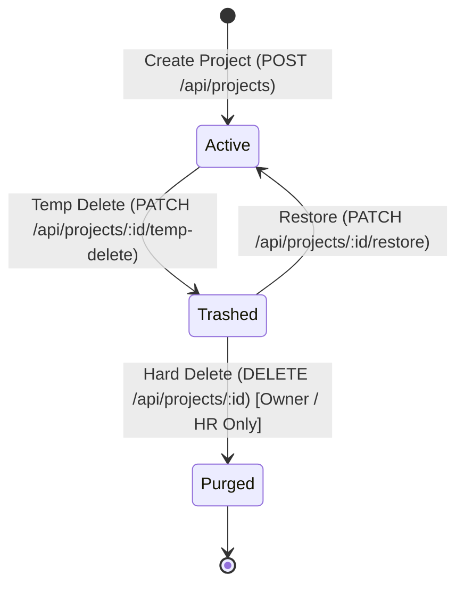

# 🚀 GetDone - Daily Task & Team Management System

A production-grade, full-stack **MERN (MongoDB, Express, React, Node.js)** task and project management web application. Built with high visual fidelity inspired by modern productivity dashboards, strict **Role-Based Access Control (RBAC)**, **Swagger OpenAPI 3.0 Documentation**, **Soft-Delete (TempDelete) / Trash Lifecycle**, and **MongoDB Atlas & Compass** support.

---

## 📑 Table of Contents
1. [Product Requirement Document (PRD)](#1-product-requirement-document-prd)
   - [Overview & Objectives](#overview--objectives)
   - [User Roles & Personas](#user-roles--personas)
   - [Access Control Matrix (RBAC)](#access-control-matrix-rbac)
   - [Functional Requirements](#functional-requirements)
2. [Technical Requirement Document (TRD)](#2-technical-requirement-document-trd)
   - [System Architecture](#system-architecture)
   - [Data Models & Schema](#data-models--schema)
   - [API Specification & Swagger](#api-specification--swagger)
   - [Soft Delete vs Permanent Delete Lifecycle](#soft-delete-vs-permanent-delete-lifecycle)
3. [Folder Structure](#3-folder-structure)
4. [Getting Started & Installation](#4-getting-started--installation)
   - [Prerequisites](#prerequisites)
   - [Backend Setup (Node + Express + MongoDB)](#backend-setup)
   - [Frontend Setup (React + Vite)](#frontend-setup)
   - [Connecting MongoDB (Compass & Atlas)](#connecting-mongodb-compass--atlas)
5. [Demo Credentials & Testing Guide](#5-demo-credentials--testing-guide)

---

## 1. Product Requirement Document (PRD)

### Overview & Objectives
**GetDone** streamlines task delegation, progress tracking, and departmental project workflows for high-growth teams. Designed to maintain transparency while enforcing strict organizational privacy and authorization hierarchies.

### User Roles & Personas
1. **Owner (`Owner`)**: Executive leader who requires 360-degree visibility over all organizational tasks across every stage (`pending`, `ongoing`, `yetToFinal`, `complete`). Authorized to permanently purge data.
2. **Admin (`Admin`)**: Operations leader overseeing active workflows (`pending`, `ongoing`, `complete`). Manages operations, reallocates tasks, and soft-deletes records. Cannot permanently destroy database records.
3. **HR (`HR`)**: People & Culture manager overseeing team assignments, onboarding, and compliance. Has full delete privileges (`Owner` + `HR`) for compliance cleanup.
4. **Employee (`Employee`)**: Execution specialist focused strictly on assigned work. Cannot see unrelated company tasks or pending internal reviews. Can create tasks (auto-assigned), update status (`ongoing` ↔ `complete`), and move tasks to trash.

---

### Access Control Matrix (RBAC)

| Capability / Rule | Owner | Admin | HR | Employee |
| :--- | :---: | :---: | :---: | :---: |
| **View All Projects** | ✅ All 4 Statuses | ✅ 3 Statuses | ✅ 3 Statuses | ❌ (Assigned only) |
| **Visible Statuses** | `pending`, `ongoing`, `yetToFinal`, `complete` | `pending`, `ongoing`, `complete` | `pending`, `ongoing`, `complete` | `ongoing`, `complete` |
| **Project Assignment Filter** | Sees all | Sees all | Sees all | **Only projects assigned to employee** |
| **Create Projects / Tasks** | ✅ Yes | ✅ Yes | ✅ Yes | ✅ Yes (Auto-assigned) |
| **Update / Edit Task** | ✅ Yes | ✅ Yes | ✅ Yes | ✅ Yes (Assigned only) |
| **Temp Delete (Trash)** | ✅ Yes | ✅ Yes | ✅ Yes | ✅ Yes (Assigned only) |
| **Restore from Trash** | ✅ Yes | ✅ Yes | ✅ Yes | ✅ Yes (Assigned only) |
| **Permanent Delete (Hard Delete)** | ✅ **Allowed** | ⛔ **Forbidden (403)** | ✅ **Allowed** | ⛔ **Forbidden (403)** |

---

### Functional Requirements
1. **Visual Kanban Board**:
   - Status columns: *Coming Next* (`pending`), *In Progress* (`ongoing`), *Yet To Final* (`yetToFinal`), and *Completed* (`complete`).
   - Cards display category badge (UI Design, Backend, HR Tech, etc.), title, description preview, stacked avatars, comments count, attachments count, and estimated hours.
2. **Summary Metric Cards**:
   - Total project done: `322` (+0.4% from last month)
   - Client onboard: `21` (+1.5% from last week)
   - New task onboard: `532` (+3.5% from last week)
   - Total hours works: `544.4 Hours` (+3.5% from last month)
3. **Task Creation & Management**:
   - Right-hand quick-entry form with title, task type chips (*Project*, *Meeting*, *Alpha Team*, *Daily Routine*, *Sprint*), due date, hours, location, and assignee multi-selection.
4. **Interactive Trash & Data Lifecycle**:
   - Soft-deleted items move to the Trash tab.
   - Dedicated Restore and Permanent Delete triggers with strict permission checks.
5. **Interactive Swagger API Documentation**:
   - Swagger UI served directly at `/api-docs`.

---

## 2. Technical Requirement Document (TRD)

### System Architecture
```
                                +---------------------------+
                                |      Browser Client       |
                                |  (React 18 + Vite Dev)    |
                                +-------------+-------------+
                                              |
                                              | REST JSON / JWT
                                              v
                                +-------------+-------------+
                                |    Express.js Web Server  |
                                |   (RBAC & Auth Middleware)|
                                +------+--------------+-----+
                                       |              |
                      +----------------+              +-----------------+
                      |                                                 |
                      v                                                 v
           +----------+----------+                           +----------+----------+
           | MongoDB Compass /   |                           |    Swagger UI       |
           | Atlas Cluster       |                           | OpenAPI 3.0 Docs    |
           | (Mongoose ODM)      |                           |    (/api-docs)      |
           +---------------------+                           +---------------------+
```

### Data Models & Schema

#### 1. User Schema (`backend/models/User.js`)
```javascript
{
  id: String,           // e.g. "user_1"
  name: String,         // Full name
  email: String,        // Unique lowercase email
  password: String,     // Hashed or demo password
  role: String,         // Enum: ['Owner', 'Admin', 'HR', 'Employee']
  title: String,        // Designation (e.g. 'Senior Frontend Developer')
  avatar: String        // Profile picture URL
}
```

#### 2. Project / Task Schema (`backend/models/Project.js`)
```javascript
{
  id: String,           // Unique identifier
  title: String,        // Project name
  desc: String,         // Detailed specification
  status: String,       // Enum: ['pending', 'ongoing', 'yetToFinal', 'complete']
  tag: String,          // Category (e.g. 'UI Design', 'Backend', 'Mobile')
  taskType: String,     // Enum: ['Project', 'Meeting', 'Alpha Team', 'Daily Routine', 'Sprint']
  assignees: [String],  // Array of User IDs assigned to task
  createdBy: String,    // User ID of author
  dueDate: String,      // Target completion date (YYYY-MM-DD)
  estimatedHours: Number, // Workload estimation
  commentsCount: Number,  // Number of discussion comments
  attachmentsCount: Number, // Number of attached assets
  location: String,     // Department or meeting room
  deleted: Boolean,     // Soft delete flag (default: false)
  deletedAt: Date,      // Timestamp when moved to trash
  deletedBy: String     // User ID who triggered soft deletion
}
```

---

### API Specification & Swagger

Swagger UI is hosted at **`http://localhost:5000/api-docs`**.

| Method | Endpoint | Description | Auth / Access |
| :--- | :--- | :--- | :--- |
| `POST` | `/api/auth/login` | Authenticate user & get JWT token | Public |
| `GET` | `/api/auth/users` | List all team members & roles | Authenticated |
| `GET` | `/api/auth/me` | Fetch active profile and permissions | Authenticated |
| `GET` | `/api/projects` | Fetch active projects (RBAC filtered) | Authenticated |
| `POST` | `/api/projects` | Create a new project / task | All Roles |
| `GET` | `/api/projects/:id` | Get details of single project | Assigned or Admin/Owner/HR |
| `PUT` | `/api/projects/:id` | Update project fields or status | Assigned or Admin/Owner/HR |
| `PATCH` | `/api/projects/:id/temp-delete` | **TempDelete**: Move project to Trash | All Roles |
| `GET` | `/api/projects/trash` | View soft-deleted projects | Role-filtered |
| `PATCH` | `/api/projects/:id/restore` | Restore soft-deleted project | Assigned or Admin/Owner/HR |
| `DELETE`| `/api/projects/:id` | **Permanent Hard Delete** | **Owner & HR ONLY** |
| `GET` | `/api/stats` | Dashboard metrics and status breakdown | Role-filtered |

---

### Soft Delete vs Permanent Delete Lifecycle



1. **Soft Delete (`TempDelete`)**: Sets `deleted: true`, recording `deletedAt` and `deletedBy`. Projects disappear from active boards and move to `/trash`.
2. **Permanent Delete**: Permanently executes `findByIdAndDelete()` in MongoDB. Strictly verified by the `requirePermanentDelete` middleware:
   ```javascript
   if (req.user.role !== 'Owner' && req.user.role !== 'HR') {
     return res.status(403).json({
       message: "Access Denied: Only 'Owner' and 'HR' roles have permanent data delete access."
     });
   }
   ```

---

## 3. Folder Structure

```
Project/
├── README.md                      # Complete PRD & TRD Documentation
├── package.json                   # Root orchestrator scripts
├── backend/                       # Node.js + Express Backend
│   ├── package.json               # Backend dependencies
│   ├── server.js                  # Express application entry
│   ├── swagger.js                 # Swagger OpenAPI 3.0 specification
│   ├── .env                       # Environment configuration
│   ├── .env.example               # Template for environment variables
│   ├── config/
│   │   ├── db.js                  # MongoDB Mongoose connection & fallback
│   │   └── seedData.js            # Default seed data for initial launch
│   ├── models/
│   │   ├── User.js                # Mongoose User model
│   │   └── Project.js             # Mongoose Project model (with soft-delete)
│   ├── middleware/
│   │   └── auth.js                # JWT & Header Auth + RBAC middleware
│   ├── services/
│   │   └── dataService.js         # Unified MongoDB & in-memory data store
│   ├── controllers/
│   │   ├── authController.js      # Login and user handlers
│   │   ├── projectController.js   # RBAC task queries, CRUD, trash lifecycle
│   │   └── statsController.js     # Dashboard metrics calculations
│   └── routes/
│       ├── authRoutes.js
│       ├── projectRoutes.js
│       └── statsRoutes.js
└── frontend/                      # React 18 + Vite Frontend
    ├── package.json               # Frontend dependencies
    ├── vite.config.js             # Vite configuration with /api proxy
    ├── index.html                 # App HTML shell with Plus Jakarta Sans
    └── src/
        ├── main.jsx               # Application entry point
        ├── App.jsx                # Core Dashboard layout & state controller
        ├── index.css              # Custom styling matching Pinterest UI
        ├── api/
        │   └── client.js          # Axios API client with auth interceptors
        └── components/
            ├── Sidebar.jsx        # Navigation & "Total Hours Works" widget
            ├── Header.jsx         # Search, 1-Click Role Switcher, Swagger Link
            ├── StatCards.jsx      # Top 3 visual metric cards
            ├── TaskBoard.jsx      # Kanban board with role-restricted columns
            ├── TaskCard.jsx       # Card with avatars, tags, comments & actions
            ├── TaskForm.jsx       # "Create a new task" panel with chips
            ├── TeamMembers.jsx    # Team list with live online indicators
            ├── TrashView.jsx      # Trash inspector with Restore & Hard Delete
            ├── EditModal.jsx      # Modal dialog for task edits
            └── Login.jsx          # Split-screen login with demo buttons
```

---

## 4. Getting Started & Installation

### Prerequisites
- **Node.js**: v18.0.0 or higher (`node -v`)
- **npm**: v9.0.0 or higher (`npm -v`)
- **MongoDB**: (Optional local MongoDB Compass or remote MongoDB Atlas cluster URI)

---

### Backend Setup

1. Open a terminal and navigate to the `backend` folder:
   ```bash
   cd "C:\Users\Anish kumar singh\Desktop\MERN(internship)\Project\backend"
   ```
2. Install dependencies:
   ```bash
   npm install
   ```
3. Start the backend development server:
   ```bash
   npm run dev
   ```
   *The server will start at **`http://localhost:5000`** and Swagger at **`http://localhost:5000/api-docs`**.*

---

### Frontend Setup

1. In a second terminal, navigate to the `frontend` directory:
   ```bash
   cd "C:\Users\Anish kumar singh\Desktop\MERN(internship)\Project\frontend"
   ```
2. Install dependencies:
   ```bash
   npm install
   ```
3. Start the Vite development server:
   ```bash
   npm run dev
   ```
   *Open **`http://localhost:3000`** (or the URL shown in your terminal) in your browser.*

---

### Connecting MongoDB (Compass & Atlas)

The backend features a **Dual-Engine Data Architecture**:
- If MongoDB is running, it connects via Mongoose and automatically populates initial collections with seed data.
- If MongoDB is temporarily offline, the server runs in-memory so you can preview the app without setup blocks.

#### Option A: Local MongoDB (Compass)
1. Launch **MongoDB Compass** on your computer.
2. Connect to: `mongodb://127.0.0.1:27017`
3. In `backend/.env`, set:
   ```env
   MONGODB_URI=mongodb://127.0.0.1:27017/getdone_db
   ```

#### Option B: MongoDB Atlas (Cloud)
1. Log into your [MongoDB Atlas](https://cloud.mongodb.com/) dashboard.
2. Copy your connection string from **Database -> Connect -> Drivers**.
3. In `backend/.env`, paste your URI:
   ```env
   MONGODB_URI=mongodb+srv://<username>:<password>@cluster0.mongodb.net/getdone_db?retryWrites=true&w=majority
   ```
4. Restart the backend server (`npm run dev`). The server will log:
   ```
   [MongoDB Connected] Host: cluster0.mongodb.net, Database: getdone_db
   ```

---

## 5. Demo Credentials & Testing Guide

To make testing instant, the app includes a **1-Click Role Switcher** in the header and quick-fill buttons on the login screen.

| Name | Role | Email | Password | RBAC Access Clearance |
| :--- | :--- | :--- | :--- | :--- |
| **Anish Owner** | `Owner` | `owner@demo.com` / `anish@demo.com` | `password123` | **Full access**: All 4 statuses (`pending`, `ongoing`, `yetToFinal`, `complete`), **Permanent Delete** allowed. |
| **Anu Admin** | `Admin` | `admin@demo.com` / `anu@demo.com` | `password123` | **Operations**: 3 statuses (`pending`, `ongoing`, `complete`), soft-delete allowed, **Permanent Delete blocked (403)**. |
| **pre HR** | `HR` | `hr@demo.com` / `pre@demo.com` | `password123` | **HR Head**: 3 statuses (`pending`, `ongoing`, `complete`), **Permanent Delete allowed**. |
| **Jitesh Employee** | `Employee`| `emp@demo.com` / `jitesh@demo.com` | `password123` | **Assigned Only**: Only views projects assigned to Jitesh (`ongoing`, `complete`), soft-delete allowed, **Permanent Delete blocked (403)**. |
| **Anshuman Singh** | `Employee`| `anshuman@demo.com` | `password123` | **Assigned Only**: Only views projects assigned to Anshuman (`ongoing`, `complete`). |
| **Sifat Sharper** | `Employee`| `sifat@demo.com` | `password123` | **Assigned Only**: Only views projects assigned to Sifat (`ongoing`, `complete`). |

### Quick Verification Scenarios:
1. **Test Owner Role**: Switch to `Anish Owner` -> Notice all columns including "Yet To Final" appear. Move an item to trash -> Navigate to Trash -> Click "Delete Permanently" -> Item is permanently removed.
2. **Test Employee Role**: Switch to `Jitesh Employee` -> Notice only assigned tasks appear. Pending tasks and unassigned tasks are hidden. Navigate to Trash -> Notice "Delete Permanently" shows "Owner / HR Only" and is disabled.
3. **Test Swagger UI**: Visit `http://localhost:5000/api-docs` to test endpoints with live JSON payloads.

---
*Developed for MERN Internship Evaluation • Built with React, Vite, Node, Express, MongoDB & Swagger.*

